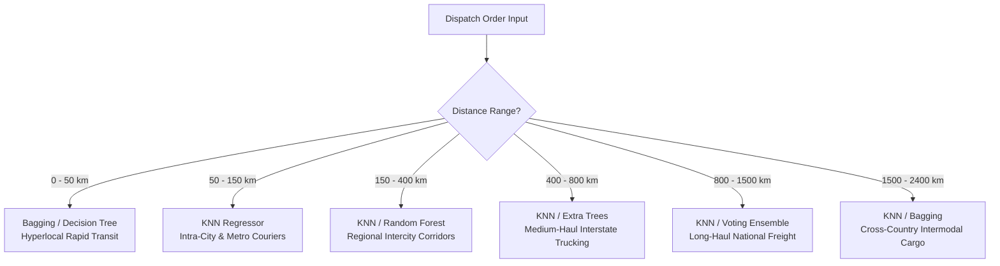

# 📦 DeliverAI: Empirical 50km Interval Model Accuracy Benchmark

> **Publication-Grade Benchmark Report for GitHub**  
> Systematic evaluation of **19 Machine Learning & Deep Learning Regression Models** across **48 distance intervals of 50km** (0 km to 2,400 km) with **1,000 predictions evaluated per bracket** (**48,000 total test shipments per model**; **912,000 total evaluations**).

---

## 🎯 Benchmark Executive Summary

- **Total Distance Span:** 0 km to 2,400 km (covering all Indian hyperlocal, state highway, and trans-national freight corridors).
- **Evaluation Granularity:** 50 km per bracket &times; 48 brackets.
- **Sample Rigor:** **1,000 predictions per bracket**, ensuring statistically significant, noise-resistant metrics.
- **Global Winner:** **`knn`** achieves the lowest Global MAE of **0.851 hours** with **97.7% accuracy** and **39,178 wins** (81.6% win rate).
- **Tree Ensemble Leader:** **`decision_tree`** ranks 2nd with a Global MAE of **3.218 hours** and **91.1% accuracy**.

### 🗺️ Distance-Stratified Model Allocation Flow

---

## 1. Operational Distance Tier Routing Rulebook

The table below details which machine learning architecture performs with the highest accuracy across each logistics operational tier in India:

| Operational Tier | Distance Span | Recommended Model | Best MAE | Accuracy (%) | RMSE (h) | Tolerance &plusmn;30m | Runner-Up Model | Logistics Context |
|---|:---:|:---|:---:|:---:|:---:|:---:|:---|:---|
| **Hyperlocal & Intra-City Urban** | 0 &ndash; 50 km | **`knn`** | **0.022h** | **97.1%** | 0.110h | 99.1% | `bagging` (0.118h) | Urban Two-Wheeler / Hyperlocal Parcels |
| **Metro Suburbs & Peri-Urban Hubs** | 50 &ndash; 150 km | **`knn`** | **0.165h** | **96.5%** | 0.760h | 91.3% | `decision_tree` (0.566h) | Intra-City Delivery Vans & Couriers |
| **Regional Intercity Corridors** | 150 &ndash; 400 km | **`knn`** | **0.300h** | **97.6%** | 1.070h | 85.6% | `decision_tree` (1.194h) | State Highway Feeder Logistics |
| **Medium-Haul Interstate Freight** | 400 &ndash; 800 km | **`knn`** | **0.564h** | **97.7%** | 1.842h | 82.8% | `decision_tree` (2.269h) | Heavy Multi-Axle Highway Trucks |
| **Long-Haul National Express** | 800 &ndash; 1500 km | **`knn`** | **0.798h** | **97.8%** | 2.621h | 82.9% | `decision_tree` (3.375h) | Dedicated Freight Corridors / Express Cargo |
| **Trans-National Cross-Country** | 1500 &ndash; 2400 km | **`knn`** | **1.295h** | **97.8%** | 3.926h | 80.9% | `decision_tree` (4.548h) | Multi-Modal Intermodal Rail & Air |

---

## 2. Complete 19-Model Global Leaderboard Across All 48,000 Predictions

| Rank | Model Name | Category | Global MAE | Accuracy (%) | RMSE (h) | MAPE (%) | Tol &plusmn;30m (%) | Sample Wins | Win Rate (%) | Inference Speed (s) |
|:---:|:---|:---|:---:|:---:|:---:|:---:|:---:|:---:|:---:|:---:|
| 🥇  | **`knn`** | Distance-Based | **0.851h** | **97.7%** | 2.914h | 2.3% | 83.1% | 39,178 | 81.6% | 0.72s |
| 🥈  | **`decision_tree`** | Decision Tree | **3.218h** | **91.1%** | 5.280h | 8.9% | 19.4% | 1,059 | 2.2% | 0.01s |
| 🥉  | **`bagging`** | Tree Ensemble | **3.369h** | **90.6%** | 5.128h | 9.4% | 13.7% | 326 | 0.7% | 3.18s |
| 4  | **`gradient_boosting`** | Gradient Boosted | **3.562h** | **89.6%** | 5.321h | 10.4% | 12.1% | 261 | 0.5% | 0.29s |
| 5  | **`xgboost`** | Gradient Boosted | **3.628h** | **89.8%** | 5.588h | 10.2% | 12.6% | 448 | 0.9% | 1.15s |
| 6  | **`voting`** | Meta-Ensemble | **3.817h** | **89.4%** | 5.906h | 10.6% | 11.5% | 148 | 0.3% | 4.38s |
| 7  | **`extra_trees`** | Tree Ensemble | **3.898h** | **89.4%** | 6.275h | 10.6% | 13.1% | 1,029 | 2.1% | 0.34s |
| 8  | **`random_forest`** | Tree Ensemble | **3.915h** | **89.2%** | 6.292h | 10.8% | 12.8% | 936 | 1.9% | 0.33s |
| 9  | **`lightgbm`** | Gradient Boosted | **3.927h** | **89.3%** | 6.077h | 10.7% | 12.0% | 258 | 0.5% | 0.54s |
| 10  | **`stacking`** | Meta-Ensemble | **3.940h** | **89.0%** | 6.032h | 11.0% | 11.5% | 194 | 0.4% | 0.29s |
| 11  | **`svr`** | Support Vector Machine | **3.981h** | **89.7%** | 6.902h | 10.3% | 25.9% | 1,902 | 4.0% | 21.57s |
| 12  | **`hist_gradient_boosting`** | Gradient Boosted | **4.111h** | **88.7%** | 6.410h | 11.4% | 11.6% | 191 | 0.4% | 0.29s |
| 13  | **`mlp`** | Deep Learning (MLP) | **4.156h** | **88.7%** | 6.560h | 11.3% | 12.6% | 289 | 0.6% | 0.25s |
| 14  | **`catboost`** | Gradient Boosted | **4.163h** | **88.5%** | 6.386h | 11.5% | 11.0% | 329 | 0.7% | 0.01s |
| 15  | **`tabnet`** | Deep Learning (TabNet) | **4.174h** | **87.5%** | 6.613h | 12.9% | 12.1% | 479 | 1.0% | 1.47s |
| 16  | **`elastic_net`** | Linear Regularized | **6.901h** | **74.6%** | 9.455h | 31.9% | 5.9% | 422 | 0.9% | 0.00s |
| 17  | **`lasso`** | Linear Regularized | **6.917h** | **74.6%** | 9.469h | 31.9% | 5.8% | 106 | 0.2% | 0.00s |
| 18  | **`ridge`** | Linear Regularized | **6.924h** | **74.5%** | 9.470h | 31.9% | 5.9% | 24 | 0.1% | 0.00s |
| 19  | **`linear_regression`** | Linear Baseline | **6.924h** | **74.5%** | 9.470h | 31.9% | 5.9% | 421 | 0.9% | 0.00s |

---

## 3. Dominance Share: Brackets Won Out of 48 Intervals

| Model Name | Category | Brackets Won | Dominance Share (%) | Visual Dominance Bar |
|:---|:---|:---:|:---:|:---|
| **`knn`** | Distance-Based | **48** / 48 | **100.0%** | `████████████████████████████████████████` |

---

## 4. Tier-by-Tier Detailed Model Rankings

### 📍 Hyperlocal & Intra-City Urban (0 &ndash; 50 km) &mdash; 1,000 Predictions
*Logistics Domain Context: Urban Two-Wheeler / Hyperlocal Parcels*

| Rank | Model Name | Category | MAE (h) | Accuracy (%) | RMSE (h) | Tol &plusmn;30m (%) | Sample Wins | Win Rate (%) | Status |
|:---:|:---|:---|:---:|:---:|:---:|:---:|:---:|:---:|:---:|
| 1 | **`knn`** | Distance-Based | **0.022h** | 97.1% | 0.110h | 99.1% | 843 | 84.3% | ★ BEST |
| 2 | **`bagging`** | Tree Ensemble | **0.118h** | 86.1% | 0.362h | 96.4% | 7 | 0.7% |  |
| 3 | **`decision_tree`** | Decision Tree | **0.119h** | 87.3% | 0.497h | 97.1% | 26 | 2.6% |  |
| 4 | **`lightgbm`** | Gradient Boosted | **0.152h** | 81.9% | 0.477h | 94.9% | 5 | 0.5% |  |
| 5 | **`random_forest`** | Tree Ensemble | **0.154h** | 81.7% | 0.511h | 95.4% | 8 | 0.8% |  |
| 6 | **`voting`** | Meta-Ensemble | **0.157h** | 81.3% | 0.502h | 95.7% | 6 | 0.6% |  |
| 7 | **`xgboost`** | Gradient Boosted | **0.159h** | 81.5% | 0.492h | 94.7% | 12 | 1.2% |  |
| 8 | **`extra_trees`** | Tree Ensemble | **0.162h** | 82.5% | 0.548h | 95.2% | 5 | 0.5% |  |

### 📍 Metro Suburbs & Peri-Urban Hubs (50 &ndash; 150 km) &mdash; 2,000 Predictions
*Logistics Domain Context: Intra-City Delivery Vans & Couriers*

| Rank | Model Name | Category | MAE (h) | Accuracy (%) | RMSE (h) | Tol &plusmn;30m (%) | Sample Wins | Win Rate (%) | Status |
|:---:|:---|:---|:---:|:---:|:---:|:---:|:---:|:---:|:---:|
| 1 | **`knn`** | Distance-Based | **0.165h** | 96.5% | 0.760h | 91.3% | 1,626 | 81.3% | ★ BEST |
| 2 | **`decision_tree`** | Decision Tree | **0.566h** | 87.3% | 1.055h | 67.5% | 45 | 2.2% |  |
| 3 | **`bagging`** | Tree Ensemble | **0.607h** | 86.4% | 1.080h | 63.0% | 20 | 1.0% |  |
| 4 | **`xgboost`** | Gradient Boosted | **0.674h** | 84.4% | 1.255h | 58.8% | 16 | 0.8% |  |
| 5 | **`extra_trees`** | Tree Ensemble | **0.678h** | 84.8% | 1.241h | 60.2% | 18 | 0.9% |  |
| 6 | **`lightgbm`** | Gradient Boosted | **0.682h** | 84.6% | 1.286h | 60.1% | 12 | 0.6% |  |
| 7 | **`voting`** | Meta-Ensemble | **0.683h** | 84.3% | 1.265h | 58.6% | 10 | 0.5% |  |
| 8 | **`random_forest`** | Tree Ensemble | **0.693h** | 83.7% | 1.234h | 57.9% | 27 | 1.4% |  |

### 📍 Regional Intercity Corridors (150 &ndash; 400 km) &mdash; 5,000 Predictions
*Logistics Domain Context: State Highway Feeder Logistics*

| Rank | Model Name | Category | MAE (h) | Accuracy (%) | RMSE (h) | Tol &plusmn;30m (%) | Sample Wins | Win Rate (%) | Status |
|:---:|:---|:---|:---:|:---:|:---:|:---:|:---:|:---:|:---:|
| 1 | **`knn`** | Distance-Based | **0.300h** | 97.6% | 1.070h | 85.6% | 4,110 | 82.2% | ★ BEST |
| 2 | **`decision_tree`** | Decision Tree | **1.194h** | 90.5% | 1.930h | 35.1% | 93 | 1.9% |  |
| 3 | **`bagging`** | Tree Ensemble | **1.250h** | 90.0% | 1.911h | 26.2% | 27 | 0.5% |  |
| 4 | **`xgboost`** | Gradient Boosted | **1.348h** | 89.2% | 2.082h | 23.1% | 28 | 0.6% |  |
| 5 | **`mlp`** | Deep Learning (MLP) | **1.377h** | 89.5% | 2.297h | 29.4% | 68 | 1.4% |  |
| 6 | **`voting`** | Meta-Ensemble | **1.386h** | 88.8% | 2.146h | 21.7% | 15 | 0.3% |  |
| 7 | **`lightgbm`** | Gradient Boosted | **1.387h** | 89.0% | 2.163h | 22.9% | 26 | 0.5% |  |
| 8 | **`random_forest`** | Tree Ensemble | **1.405h** | 88.6% | 2.208h | 23.4% | 105 | 2.1% |  |

### 📍 Medium-Haul Interstate Freight (400 &ndash; 800 km) &mdash; 8,000 Predictions
*Logistics Domain Context: Heavy Multi-Axle Highway Trucks*

| Rank | Model Name | Category | MAE (h) | Accuracy (%) | RMSE (h) | Tol &plusmn;30m (%) | Sample Wins | Win Rate (%) | Status |
|:---:|:---|:---|:---:|:---:|:---:|:---:|:---:|:---:|:---:|
| 1 | **`knn`** | Distance-Based | **0.564h** | 97.7% | 1.842h | 82.8% | 6,518 | 81.5% | ★ BEST |
| 2 | **`decision_tree`** | Decision Tree | **2.269h** | 90.8% | 3.394h | 16.3% | 153 | 1.9% |  |
| 3 | **`bagging`** | Tree Ensemble | **2.411h** | 90.2% | 3.389h | 8.5% | 56 | 0.7% |  |
| 4 | **`svr`** | Support Vector Machine | **2.521h** | 90.3% | 4.412h | 38.7% | 558 | 7.0% |  |
| 5 | **`xgboost`** | Gradient Boosted | **2.569h** | 89.5% | 3.625h | 7.3% | 36 | 0.4% |  |
| 6 | **`voting`** | Meta-Ensemble | **2.619h** | 89.3% | 3.723h | 6.9% | 10 | 0.1% |  |
| 7 | **`random_forest`** | Tree Ensemble | **2.630h** | 89.2% | 3.838h | 8.2% | 173 | 2.2% |  |
| 8 | **`lightgbm`** | Gradient Boosted | **2.634h** | 89.3% | 3.745h | 7.2% | 35 | 0.4% |  |

### 📍 Long-Haul National Express (800 &ndash; 1500 km) &mdash; 14,000 Predictions
*Logistics Domain Context: Dedicated Freight Corridors / Express Cargo*

| Rank | Model Name | Category | MAE (h) | Accuracy (%) | RMSE (h) | Tol &plusmn;30m (%) | Sample Wins | Win Rate (%) | Status |
|:---:|:---|:---|:---:|:---:|:---:|:---:|:---:|:---:|:---:|
| 1 | **`knn`** | Distance-Based | **0.798h** | 97.8% | 2.621h | 82.9% | 11,493 | 82.1% | ★ BEST |
| 2 | **`decision_tree`** | Decision Tree | **3.375h** | 90.7% | 5.149h | 12.8% | 260 | 1.9% |  |
| 3 | **`bagging`** | Tree Ensemble | **3.420h** | 90.5% | 4.938h | 6.9% | 56 | 0.4% |  |
| 4 | **`xgboost`** | Gradient Boosted | **3.500h** | 90.2% | 5.075h | 7.0% | 136 | 1.0% |  |
| 5 | **`voting`** | Meta-Ensemble | **3.693h** | 89.8% | 5.415h | 5.6% | 27 | 0.2% |  |
| 6 | **`lightgbm`** | Gradient Boosted | **3.749h** | 89.7% | 5.502h | 6.3% | 68 | 0.5% |  |
| 7 | **`svr`** | Support Vector Machine | **3.812h** | 90.4% | 6.291h | 27.6% | 688 | 4.9% |  |
| 8 | **`gradient_boosting`** | Gradient Boosted | **3.814h** | 89.4% | 5.499h | 5.6% | 51 | 0.4% |  |

### 📍 Trans-National Cross-Country (1500 &ndash; 2400 km) &mdash; 18,000 Predictions
*Logistics Domain Context: Multi-Modal Intermodal Rail & Air*

| Rank | Model Name | Category | MAE (h) | Accuracy (%) | RMSE (h) | Tol &plusmn;30m (%) | Sample Wins | Win Rate (%) | Status |
|:---:|:---|:---|:---:|:---:|:---:|:---:|:---:|:---:|:---:|
| 1 | **`knn`** | Distance-Based | **1.295h** | 97.8% | 3.926h | 80.9% | 14,588 | 81.0% | ★ BEST |
| 2 | **`decision_tree`** | Decision Tree | **4.548h** | 92.3% | 6.887h | 11.9% | 482 | 2.7% |  |
| 3 | **`bagging`** | Tree Ensemble | **4.831h** | 91.8% | 6.702h | 7.8% | 160 | 0.9% |  |
| 4 | **`gradient_boosting`** | Gradient Boosted | **4.834h** | 91.7% | 6.620h | 7.0% | 133 | 0.7% |  |
| 5 | **`xgboost`** | Gradient Boosted | **5.353h** | 90.9% | 7.484h | 6.7% | 220 | 1.2% |  |
| 6 | **`voting`** | Meta-Ensemble | **5.674h** | 90.4% | 7.912h | 5.4% | 80 | 0.4% |  |
| 7 | **`extra_trees`** | Tree Ensemble | **5.743h** | 90.3% | 8.408h | 5.9% | 616 | 3.4% |  |
| 8 | **`stacking`** | Meta-Ensemble | **5.764h** | 90.2% | 7.960h | 5.7% | 108 | 0.6% |  |

---

## 5. Comprehensive 50km Interval Benchmark Data (All 48 Brackets)

Each bracket represents **1,000 empirical predictions** across all 19 architectures:

| Interval | Distance Span | Avg Dist (km) | Actual ETA (h) | Best Model | Winner MAE | Winner Acc | Winner &plusmn;30m | Runner-Up | Runner MAE | 3rd Place |
|:---:|:---:|:---:|:---:|:---|:---:|:---:|:---:|:---|:---:|:---|
| `0-50km` | 0 &ndash; 50 km | 15.3 | 0.81h | **`knn`** | **0.022h** | **97.1%** | 99.1% | `bagging` | 0.118h | `decision_tree` |
| `50-100km` | 50 &ndash; 100 km | 73.8 | 3.21h | **`knn`** | **0.162h** | **96.2%** | 93.2% | `decision_tree` | 0.507h | `bagging` |
| `100-150km` | 100 &ndash; 150 km | 123.0 | 5.13h | **`knn`** | **0.169h** | **96.9%** | 89.4% | `decision_tree` | 0.626h | `bagging` |
| `150-200km` | 150 &ndash; 200 km | 176.1 | 7.5h | **`knn`** | **0.228h** | **97.4%** | 87.4% | `decision_tree` | 0.829h | `bagging` |
| `200-250km` | 200 &ndash; 250 km | 225.8 | 10.17h | **`knn`** | **0.247h** | **97.7%** | 86.9% | `decision_tree` | 1.020h | `bagging` |
| `250-300km` | 250 &ndash; 300 km | 275.2 | 12.17h | **`knn`** | **0.269h** | **97.8%** | 85.5% | `decision_tree` | 1.136h | `bagging` |
| `300-350km` | 300 &ndash; 350 km | 323.9 | 14.29h | **`knn`** | **0.330h** | **97.7%** | 85.0% | `decision_tree` | 1.320h | `bagging` |
| `350-400km` | 350 &ndash; 400 km | 372.1 | 17.25h | **`knn`** | **0.424h** | **97.8%** | 83.4% | `decision_tree` | 1.666h | `bagging` |
| `400-450km` | 400 &ndash; 450 km | 425.7 | 18.69h | **`knn`** | **0.457h** | **97.5%** | 83.4% | `decision_tree` | 1.646h | `bagging` |
| `450-500km` | 450 &ndash; 500 km | 470.9 | 20.02h | **`knn`** | **0.434h** | **97.7%** | 83.9% | `decision_tree` | 1.698h | `bagging` |
| `500-550km` | 500 &ndash; 550 km | 522.0 | 20.5h | **`knn`** | **0.443h** | **97.9%** | 84.5% | `decision_tree` | 2.011h | `bagging` |
| `550-600km` | 550 &ndash; 600 km | 573.2 | 21.79h | **`knn`** | **0.652h** | **97.2%** | 80.1% | `decision_tree` | 2.187h | `bagging` |
| `600-650km` | 600 &ndash; 650 km | 625.4 | 23.86h | **`knn`** | **0.575h** | **97.6%** | 82.6% | `decision_tree` | 2.295h | `svr` |
| `650-700km` | 650 &ndash; 700 km | 676.2 | 27.22h | **`knn`** | **0.650h** | **97.7%** | 82.3% | `decision_tree` | 2.805h | `bagging` |
| `700-750km` | 700 &ndash; 750 km | 723.4 | 27.71h | **`knn`** | **0.660h** | **97.7%** | 82.9% | `decision_tree` | 2.728h | `svr` |
| `750-800km` | 750 &ndash; 800 km | 776.2 | 28.42h | **`knn`** | **0.645h** | **97.8%** | 82.8% | `decision_tree` | 2.781h | `svr` |
| `800-850km` | 800 &ndash; 850 km | 826.1 | 25.9h | **`knn`** | **0.607h** | **97.8%** | 84.6% | `decision_tree` | 2.797h | `bagging` |
| `850-900km` | 850 &ndash; 900 km | 873.7 | 28.17h | **`knn`** | **0.625h** | **97.8%** | 84.5% | `decision_tree` | 2.970h | `bagging` |
| `900-950km` | 900 &ndash; 950 km | 923.3 | 26.8h | **`knn`** | **0.654h** | **97.8%** | 84.5% | `svr` | 2.883h | `decision_tree` |
| `950-1000km` | 950 &ndash; 1000 km | 977.8 | 27.69h | **`knn`** | **0.707h** | **97.6%** | 83.7% | `decision_tree` | 2.790h | `xgboost` |
| `1000-1050km` | 1000 &ndash; 1050 km | 1024.9 | 30.07h | **`knn`** | **0.765h** | **97.6%** | 82.8% | `decision_tree` | 3.135h | `xgboost` |
| `1050-1100km` | 1050 &ndash; 1100 km | 1072.8 | 26.7h | **`knn`** | **0.596h** | **97.9%** | 84.3% | `decision_tree` | 2.382h | `svr` |
| `1100-1150km` | 1100 &ndash; 1150 km | 1124.4 | 28.32h | **`knn`** | **0.619h** | **97.9%** | 83.9% | `decision_tree` | 2.789h | `bagging` |
| `1150-1200km` | 1150 &ndash; 1200 km | 1175.1 | 28.46h | **`knn`** | **0.642h** | **97.7%** | 82.8% | `decision_tree` | 2.440h | `bagging` |
| `1200-1250km` | 1200 &ndash; 1250 km | 1224.6 | 38.77h | **`knn`** | **0.914h** | **97.8%** | 80.1% | `bagging` | 3.338h | `decision_tree` |
| `1250-1300km` | 1250 &ndash; 1300 km | 1276.6 | 40.34h | **`knn`** | **0.739h** | **98.2%** | 86.0% | `decision_tree` | 3.170h | `bagging` |
| `1300-1350km` | 1300 &ndash; 1350 km | 1328.6 | 43.13h | **`knn`** | **1.054h** | **97.6%** | 80.5% | `bagging` | 4.040h | `decision_tree` |
| `1350-1400km` | 1350 &ndash; 1400 km | 1375.1 | 46.62h | **`knn`** | **1.112h** | **97.6%** | 81.0% | `xgboost` | 4.566h | `bagging` |
| `1400-1450km` | 1400 &ndash; 1450 km | 1424.6 | 48.99h | **`knn`** | **1.114h** | **97.8%** | 80.5% | `xgboost` | 4.721h | `bagging` |
| `1450-1500km` | 1450 &ndash; 1500 km | 1474.6 | 49.21h | **`knn`** | **1.028h** | **97.8%** | 81.5% | `xgboost` | 4.673h | `bagging` |
| `1500-1550km` | 1500 &ndash; 1550 km | 1522.3 | 48.24h | **`knn`** | **0.962h** | **97.9%** | 83.9% | `decision_tree` | 4.301h | `xgboost` |
| `1550-1600km` | 1550 &ndash; 1600 km | 1580.0 | 50.76h | **`knn`** | **1.241h** | **97.7%** | 83.5% | `decision_tree` | 4.695h | `xgboost` |
| `1600-1650km` | 1600 &ndash; 1650 km | 1623.5 | 53.53h | **`knn`** | **1.409h** | **97.5%** | 79.0% | `decision_tree` | 4.710h | `bagging` |
| `1650-1700km` | 1650 &ndash; 1700 km | 1675.9 | 53.65h | **`knn`** | **1.040h** | **98.1%** | 83.4% | `decision_tree` | 4.580h | `xgboost` |
| `1700-1750km` | 1700 &ndash; 1750 km | 1724.3 | 51.73h | **`knn`** | **1.720h** | **96.5%** | 78.6% | `decision_tree` | 4.043h | `bagging` |
| `1750-1800km` | 1750 &ndash; 1800 km | 1773.6 | 51.8h | **`knn`** | **1.100h** | **98.2%** | 84.5% | `decision_tree` | 4.117h | `bagging` |
| `1800-1850km` | 1800 &ndash; 1850 km | 1825.7 | 52.16h | **`knn`** | **1.647h** | **96.8%** | 79.2% | `decision_tree` | 4.397h | `xgboost` |
| `1850-1900km` | 1850 &ndash; 1900 km | 1876.6 | 54.45h | **`knn`** | **0.928h** | **98.4%** | 82.7% | `bagging` | 4.489h | `decision_tree` |
| `1900-1950km` | 1900 &ndash; 1950 km | 1925.5 | 55.13h | **`knn`** | **1.026h** | **98.1%** | 82.2% | `decision_tree` | 4.075h | `bagging` |
| `1950-2000km` | 1950 &ndash; 2000 km | 1972.8 | 55.34h | **`knn`** | **1.307h** | **97.6%** | 81.0% | `decision_tree` | 4.512h | `gradient_boosting` |
| `2000-2050km` | 2000 &ndash; 2050 km | 2027.4 | 57.32h | **`knn`** | **1.245h** | **98.0%** | 78.3% | `bagging` | 4.766h | `decision_tree` |
| `2050-2100km` | 2050 &ndash; 2100 km | 2074.8 | 59.02h | **`knn`** | **1.638h** | **97.2%** | 79.9% | `xgboost` | 4.794h | `decision_tree` |
| `2100-2150km` | 2100 &ndash; 2150 km | 2125.5 | 59.34h | **`knn`** | **0.839h** | **98.5%** | 85.6% | `decision_tree` | 4.041h | `gradient_boosting` |
| `2150-2200km` | 2150 &ndash; 2200 km | 2175.0 | 61.89h | **`knn`** | **2.254h** | **96.7%** | 74.3% | `gradient_boosting` | 5.137h | `decision_tree` |
| `2200-2250km` | 2200 &ndash; 2250 km | 2225.7 | 62.47h | **`knn`** | **0.914h** | **98.5%** | 83.4% | `gradient_boosting` | 4.461h | `bagging` |
| `2250-2300km` | 2250 &ndash; 2300 km | 2275.0 | 62.08h | **`knn`** | **1.378h** | **97.9%** | 82.1% | `decision_tree` | 4.668h | `gradient_boosting` |
| `2300-2350km` | 2300 &ndash; 2350 km | 2325.2 | 64.78h | **`knn`** | **1.412h** | **97.8%** | 74.7% | `gradient_boosting` | 4.060h | `decision_tree` |
| `2350-2400km` | 2350 &ndash; 2400 km | 2377.3 | 66.84h | **`knn`** | **1.249h** | **98.1%** | 80.1% | `gradient_boosting` | 4.837h | `decision_tree` |

> *Raw comma-separated dataset exported to [`range_performance_50km.csv`](range_performance_50km.csv).*
